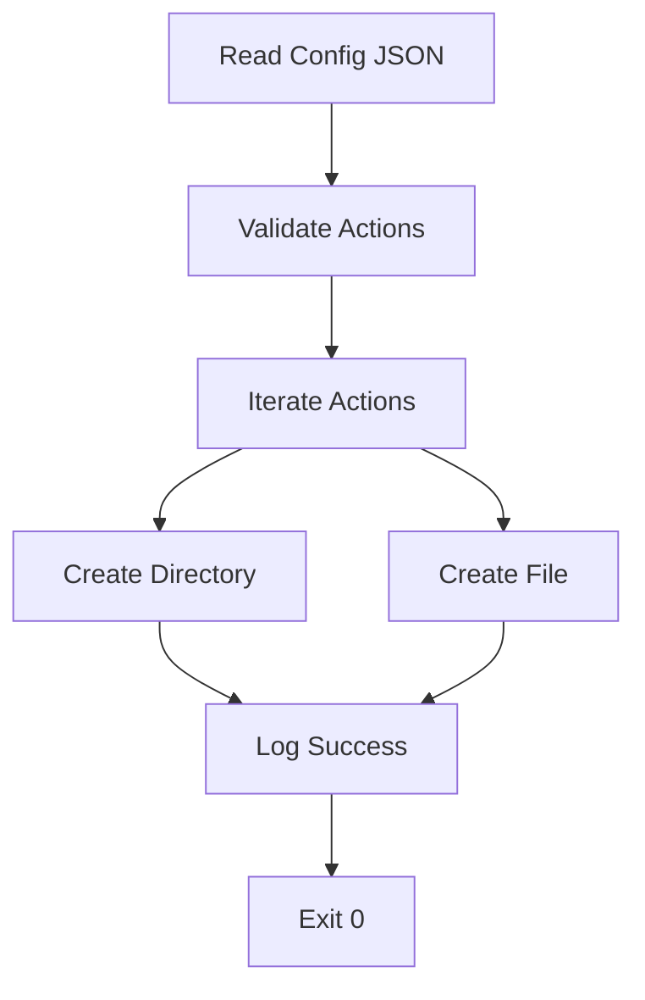

# FlowForge CLI
## Supercharge your dev workflow with instant scaffolding and automation

[](https://nodejs.org/)
[](LICENSE)
[]()
[]()
[]()

### Installation

```bash
git clone https://github.com/yourname/flowforge-cli.git
cd flowforge-cli
node src/index.js --help
```

### Quick Start

Create a `flowforge.json` configuration:

```json
{
  "actions": [
    { "type": "dir", "path": "src/utils" },
    { "type": "file", "path": "src/utils/logger.js", "content": "export const log = (msg) => console.log(msg);" }
  ]
}
```

Run the CLI:

```bash
node src/index.js flowforge.json
```

You will see:

```
Created directory: src/utils
Created file: src/utils/logger.js
Scaffolding complete.
```

### Architecture



### Test Results

## 🧪 Real-World Test Telemetry

> [!NOTE]
> Verified automatically using Node.js native test runner (`node:test` & `node:assert/strict`).

```bash
▶ node --test
TAP version 13
# Subtest: CLI creates files and directories from config
ok 1 - CLI creates files and directories from config
  ---
  duration_ms: 31.945207
  ...
1..1
# tests 1
# suites 0
# pass 1
# fail 0
# cancelled 0
# skipped 0
# todo 0
# duration_ms 73.585648
```